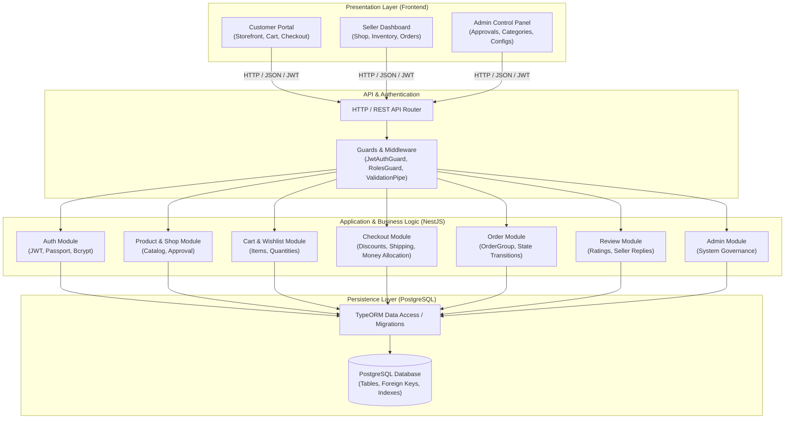

<div align="center">

# MarketNest

### Nền tảng Thương mại Điện tử Đa Người bán (Multi-Vendor E-Commerce Platform)

[](https://react.dev/)
[](https://vite.dev/)
[](https://www.typescriptlang.org/)
[](https://nestjs.com/)
[](https://www.postgresql.org/)
[](https://typeorm.io/)
[](https://vitest.dev/)
[](https://playwright.dev/)
[](https://www.postman.com/)
[](https://jmeter.apache.org/)

</div>

---

## Mục lục

- [Phần 1: Kiến trúc hệ thống (System Architecture)](#phần-1-kiến-trúc-hệ-thống-system-architecture)
  - [1. Tổng quan hệ thống](#1-tổng-quan-hệ-thống)
  - [2. Sơ đồ kiến trúc tổng thể](#2-sơ-đồ-kiến-trúc-tổng-thể)
  - [3. Công nghệ sử dụng (Technology Stack)](#3-công-nghệ-sử-dụng-technology-stack)
  - [4. Mô hình dữ liệu và thực thể nghiệp vụ (Domain Entities)](#4-mô-hình-dữ-liệu-và-thực-thể-nghiệp-vụ-domain-entities)
  - [5. Luồng xử lý nghiệp vụ cốt lõi (Core Business Workflows)](#5-luồng-xử-lý-nghiệp-vụ-cốt-lõi-core-business-workflows)
  - [6. Cấu trúc thư mục dự án (Project Directory Structure)](#6-cấu-trúc-thư-mục-dự-án-project-directory-structure)
  - [7. Hướng dẫn cài đặt và khởi chạy (Installation & Setup)](#7-hướng-dẫn-cài-đặt-và-khởi-chạy-installation--setup)
- [Phần 2: Kiểm thử hệ thống (Testing)](#phần-2-kiểm-thử-hệ-thống-testing)
  - [1. Chiến lược và mô hình kiểm thử (Testing Strategy)](#1-chiến-lược-và-mô-hình-kiểm-thử-testing-strategy)
  - [2. Kiểm thử đơn vị (Unit Testing) với Vitest](#2-kiểm-thử-đơn-vị-unit-testing-với-vitest)
  - [3. Kiểm thử API (API Testing) với Postman](#3-kiểm-thử-api-api-testing-với-postman)
  - [4. Kiểm thử tự động đầu-cuối (End-to-End UI Testing) với Playwright](#4-kiểm-thử-tự-động-đầu-cuối-end-to-end-ui-testing-với-playwright)
  - [5. Kiểm thử hiệu năng và tải (Performance & Load Testing) với Apache JMeter](#5-kiểm-thử-hiệu-năng-và-tải-performance--load-testing-với-apache-jmeter)
  - [6. Tổng hợp lệnh chạy kiểm thử (Quick Test Commands)](#6-tổng-hợp-lệnh-chạy-kiểm-thử-quick-test-commands)

---

# Phần 1: Kiến trúc hệ thống (System Architecture)

## 1. Tổng quan hệ thống

**MarketNest** là hệ thống thương mại điện tử đa người bán (Multi-Vendor E-Commerce Platform) được xây dựng theo kiến trúc phân tầng hiện đại (Layered Architecture). Hệ thống cung cấp đầy đủ các cổng giao tiếp và chức năng cho 3 nhóm đối tượng người dùng chính:

- **Khách hàng (Customer):** Đăng ký/đăng nhập, tìm kiếm và duyệt danh mục sản phẩm, quản lý giỏ hàng và danh sách yêu thích (Wishlist), đặt hàng (Checkout) hỗ trợ gom đơn từ nhiều người bán, theo dõi trạng thái đơn hàng, xác nhận nhận hàng và đánh giá sản phẩm.
- **Người bán (Seller):** Đăng ký mở gian hàng (Shop), quản lý thông tin cửa hàng, tạo và quản lý sản phẩm, quản lý tồn kho (Inventory), tiếp nhận và xử lý đơn hàng (xác nhận, giao hàng), phản hồi đánh giá của khách hàng và xem thống kê doanh thu.
- **Quản trị viên (Admin):** Quản lý toàn bộ người dùng, phê duyệt/từ chối gian hàng, kiểm duyệt sản phẩm đăng bán, quản lý danh mục (Categories), cấu hình mã giảm giá (Discounts), phí vận chuyển (Shipping configuration) và giám sát toàn bộ hoạt động giao dịch trên sàn.

## 2. Sơ đồ kiến trúc tổng thể

Hệ thống được thiết kế theo mô hình Client - Server với cơ chế bảo mật xác thực bằng JWT (JSON Web Tokens) và phân quyền theo vai trò (Role-Based Access Control - RBAC).



### Kiến trúc phân tầng (3-Tier Layered Architecture)

1. **Presentation Layer (Frontend - React & Vite):**
   - Đảm nhận toàn bộ giao diện người dùng và trải nghiệm người dùng (SPA).
   - Quản lý trạng thái xác thực phiên làm việc thông qua React Context (`AuthContext`).
   - Giao tiếp với backend thông qua Axios client có tích hợp Interceptors tự động đính kèm Bearer JWT Token vào Header của mỗi request.
2. **Business Logic Layer (Backend - NestJS):**
   - Đóng vai trò là trung tâm xử lý toàn bộ logic nghiệp vụ (Single Source of Truth).
   - Thiết kế dạng Modular: Mỗi miền nghiệp vụ (Auth, User, Product, Shop, Cart, Checkout, Order, Review, Admin) được đóng gói trong một Module độc lập với Controller, Service và Entity riêng biệt.
   - Bảo mật & Kiểm soát truy cập: Tích hợp `JwtAuthGuard`, `RolesGuard` (`CUSTOMER`, `SELLER`, `ADMIN`), và `ValidationPipe` (sử dụng `class-validator` và `class-transformer` để kiểm tra tính hợp lệ của DTO).
   - Xử lý giao dịch an toàn (ACID Transactions): Các nghiệp vụ thanh toán, trừ tồn kho và tạo đơn hàng đều chạy trong Database Transaction để chống thất thoát và sai lệch dữ liệu.
3. **Data Persistence Layer (Database - PostgreSQL & TypeORM):**
   - Sử dụng hệ quản trị cơ sở dữ liệu quan hệ PostgreSQL với các ràng buộc khóa ngoại (Foreign Keys), khóa chính (Primary Keys), ràng buộc duy nhất (Unique Constraints) và chỉ mục (Indexes).
   - Quản lý lược đồ dữ liệu bằng TypeORM Migrations phiên bản hóa, nghiêm cấm dùng `synchronize: true` trên môi trường vận hành thực tế.

## 3. Công nghệ sử dụng (Technology Stack)

| Thành phần | Công nghệ / Thư viện | Mô tả |
| :--- | :--- | :--- |
| **Frontend** | React 19, TypeScript 6, Vite 8 | Xây dựng giao diện Single Page Application hiện đại, tốc độ cao |
| | React Router DOM v7 | Quản lý định tuyến và bảo vệ route theo vai trò (Protected Routes) |
| | Axios | Xử lý các HTTP Request và Interceptor quản lý token |
| **Backend** | NestJS 12, Node.js (ESM) | Framework backend theo kiến trúc Module, Dependency Injection mạnh mẽ |
| | TypeORM 1.1 | Object-Relational Mapping (ORM) cho cơ sở dữ liệu quan hệ |
| | Passport & Passport-JWT | Cơ chế xác thực phân tán dựa trên JSON Web Token |
| | Bcrypt | Mã hóa mật khẩu bảo mật một chiều |
| | class-validator & class-transformer | Kiểm thực dữ liệu đầu vào (DTO validation) tự động |
| **Database** | PostgreSQL | Hệ quản trị cơ sở dữ liệu quan hệ tin cậy, hỗ trợ giao dịch ACID |
| **DevOps & Testing** | Docker, Docker Compose | Đóng gói và chuẩn hóa môi trường triển khai |
| | Vitest 4 | Khung kiểm thử đơn vị (Unit Testing) tốc độ cao |
| | Playwright 1.50 (Python) | Tự động hóa kiểm thử giao diện đầu-cuối (E2E UI Testing) |
| | Postman | Kiểm thử chức năng và tích hợp REST API |
| | Apache JMeter | Kiểm thử hiệu năng, độ chịu tải và thông lượng hệ thống |

## 4. Mô hình dữ liệu và thực thể nghiệp vụ (Domain Entities)

Hệ thống quản lý dữ liệu trên PostgreSQL với các nhóm thực thể chính:

- **Identity & Access Management:**
  - `User`: Tài khoản đăng nhập hệ thống (email, mật khẩu băm, vai trò `role`: CUSTOMER, SELLER, ADMIN, trạng thái hoạt động).
  - `Customer`: Thông tin chi tiết của khách hàng (họ tên, số điện thoại, địa chỉ giao hàng).
  - `Seller`: Thông tin hồ sơ đối tác bán hàng.
  - `Admin`: Thông tin tài khoản quản trị hệ thống.
- **Catalog & Inventory:**
  - `Shop`: Cửa hàng của người bán (tên shop, mô tả, logo, trạng thái `status`: PENDING, ACTIVE, SUSPENDED, REJECTED).
  - `Category`: Danh mục sản phẩm đa cấp do Admin cấu hình.
  - `Product`: Thông tin sản phẩm (tên, mô tả, giá niêm yết, danh mục, trạng thái `status`: PENDING, APPROVED, REJECTED).
  - `Inventory`: Quản lý kho hàng cho từng sản phẩm (số lượng thực tế `quantity`, số lượng đang được giữ trong đơn hàng `reservedQuantity`).
- **Shopping Experience:**
  - `Cart` & `CartItem`: Giỏ hàng của khách hàng, lưu trữ sản phẩm và số lượng chọn mua.
  - `Wishlist` & `WishlistItem`: Danh sách sản phẩm người dùng đánh dấu quan tâm.
- **Order & Payment Processing:**
  - `OrderGroup`: Nhóm đơn hàng cha được sinh ra khi khách hàng thanh toán nhiều sản phẩm từ nhiều Shop khác nhau trong một phiên checkout.
  - `Order`: Đơn hàng con tương ứng với từng Shop cụ thể (trạng thái: `PENDING`, `CONFIRMED`, `SHIPPING`, `COMPLETED`, `CANCELLED`).
  - `OrderItem`: Chi tiết từng dòng sản phẩm trong đơn (giá bán tại thời điểm mua, số lượng, thành tiền).
  - `Payment`: Thông tin thanh toán (phương thức: COD, trạng thái thanh toán).
- **Engagement & Policies:**
  - `Review`: Đánh giá (số sao 1-5, bình luận) của khách hàng sau khi nhận hàng và phản hồi của người bán.
  - `Discount`: Mã giảm giá toàn sàn hoặc theo shop (theo số tiền cố định hoặc tỷ lệ phần trăm).
  - `ShippingConfig`: Cấu hình phí vận chuyển mặc định theo khoảng giá trị đơn hàng.

## 5. Luồng xử lý nghiệp vụ cốt lõi (Core Business Workflows)

### 5.1. Luồng Xác thực & Phân quyền (Authentication & Authorization)

```text
Khách hàng / Người bán / Admin gửi credentials (POST /auth/login)
  -> NestJS xác thực qua bcrypt & Local Strategy
  -> Sinh JWT Access Token (hạn ngắn) & Refresh Token
  -> Client lưu trữ Token và đính kèm vào HTTP Header (Authorization: Bearer <token>)
  -> JwtAuthGuard giải mã token -> RolesGuard kiểm tra quyền truy cập endpoint
```

### 5.2. Luồng Vòng đời Sản phẩm (Product Lifecycle)

```text
1. Người bán tạo sản phẩm (POST /shops/products) -> Trạng thái: PENDING
2. Quản trị viên duyệt sản phẩm (PATCH /admin/products/:id/approve) -> Trạng thái: APPROVED
3. Sản phẩm hiển thị công khai trên Storefront (GET /products)
4. Khách hàng xem chi tiết, kiểm tra tồn kho và thêm vào giỏ hàng
```

### 5.3. Luồng Đặt hàng và Phân chia Đơn hàng Đa Người bán (Multi-Vendor Checkout)

Hệ thống cho phép khách hàng chọn cùng lúc sản phẩm từ nhiều Shop khác nhau trong giỏ hàng:

```text
1. Khách hàng chọn các CartItems muốn mua -> POST /checkout/preview
2. Hệ thống tính toán:
   - Subtotal theo từng Shop
   - Áp dụng mã giảm giá (Discount) và phân bổ giá trị chiết khấu chính xác theo trọng số từng Shop
   - Tính phí vận chuyển (Shipping fee)
3. Khách hàng xác nhận đặt hàng -> POST /checkout (Transaction):
   - Tạo bản ghi OrderGroup (Mã MN-XXXXXX)
   - Tách thành các đơn con Order tương ứng với từng Shop
   - Kiểm tra và trừ tồn kho (Inventory decrement)
   - Xóa các item đã mua khỏi giỏ hàng
4. Người bán nhận đơn -> Xác nhận (CONFIRMED) -> Giao hàng (SHIPPING)
5. Khách hàng nhận hàng -> Xác nhận nhận hàng (COMPLETED) -> Viết đánh giá (Review)
```

## 6. Cấu trúc thư mục dự án (Project Directory Structure)

```text
ecommerce-system/
├── backend/                        # Ứng dụng Backend NestJS
│   ├── src/
│   │   ├── common/                 # Guards, Decorators, Enums, Interfaces dùng chung
│   │   ├── configs/                # Cấu hình Database, JWT, App Config
│   │   ├── database/               # Data source & TypeORM Migrations
│   │   └── modules/                # Các module nghiệp vụ (Auth, Product, Shop, Cart, Checkout, Order, Review, Admin)
│   ├── test/                       # Cấu hình kiểm thử tích hợp (e2e)
│   ├── vitest.config.ts            # Cấu hình kiểm thử đơn vị với Vitest
│   ├── package.json                # Dependencies và scripts backend
│   └── .env.example                # File mẫu biến môi trường backend
├── frontend/                       # Ứng dụng Frontend React + Vite
│   ├── src/
│   │   ├── api/                    # Cấu hình Axios client và API callers
│   │   ├── components/             # Các component giao diện dùng chung
│   │   ├── context/                # AuthContext quản lý phiên đăng nhập
│   │   ├── layouts/                # Layouts cho Customer, Seller, Admin
│   │   ├── pages/                  # Các trang giao diện theo vai trò người dùng
│   │   ├── routes/                 # Quản lý định tuyến và Protected Routes
│   │   └── types/                  # TypeScript interface định nghĩa kiểu dữ liệu
│   ├── package.json                # Dependencies và scripts frontend
│   └── .env.example                # File mẫu biến môi trường frontend
├── ui-tests/                       # Bộ kiểm thử giao diện tự động E2E với Playwright (Python)
│   ├── screenshots/                # Ảnh chụp màn hình kết quả kiểm thử
│   ├── test_homepage.py            # Kiểm thử hiển thị trang chủ
│   ├── test_login.py               # Kiểm thử luồng đăng nhập (hợp lệ / không hợp lệ)
│   ├── test_search.py              # Kiểm thử tìm kiếm sản phẩm
│   ├── test_cart.py                # Kiểm thử thao tác giỏ hàng
│   ├── test_wishlist.py            # Kiểm thử danh sách yêu thích
│   ├── test_checkout.py            # Kiểm thử hoàn tất đặt hàng
│   ├── test_order.py               # Kiểm thử xem chi tiết đơn hàng
│   ├── test_receive_order.py       # Kiểm thử xác nhận nhận hàng
│   ├── test_seller_order.py        # Kiểm thử quy trình xử lý đơn của người bán
│   └── test_admin_product.py       # Kiểm thử quy trình duyệt sản phẩm của Admin
└── README.md                       # Tài liệu hướng dẫn hệ thống & kiểm thử
```

## 7. Hướng dẫn cài đặt và khởi chạy (Installation & Setup)

### Yêu cầu môi trường

- **Node.js**: Phiên bản 20.x hoặc mới hơn
- **PostgreSQL**: Phiên bản 15.x trở lên
- **Python**: Phiên bản 3.10+ (sử dụng khi chạy bộ kiểm thử UI Playwright)

### Bước 1: Cấu hình Cơ sở dữ liệu PostgreSQL

Tạo một database trống trên PostgreSQL (ví dụ tên: `marketnest`):

```sql
CREATE DATABASE marketnest;
```

### Bước 2: Cài đặt và khởi chạy Backend (NestJS)

1. Di chuyển vào thư mục backend và cài đặt thư viện:
   ```bash
   cd backend
   npm install
   ```

2. Tạo file cấu hình môi trường `.env` từ `.env.example`:
   - Trên Linux/macOS: `cp .env.example .env`
   - Trên Windows PowerShell: `Copy-Item .env.example .env`

3. Chỉnh sửa thông số kết nối Database trong file `backend/.env`:
   ```dotenv
   DB_HOST=localhost
   DB_PORT=5432
   DB_USERNAME=postgres
   DB_PASSWORD=your_password
   DB_NAME=marketnest
   DB_SSL=false

   JWT_ACCESS_SECRET=your_jwt_access_secret_key_here
   JWT_ACCESS_EXPIRES_IN=15m
   JWT_REFRESH_SECRET=your_jwt_refresh_secret_key_here
   JWT_REFRESH_EXPIRES_IN=7d
   ```

4. Chạy migration để khởi tạo cấu trúc bảng:
   ```bash
   npm run migration:run
   ```

5. Khởi động Backend server:
   ```bash
   npm run start:dev
   ```
   *Backend mặc định chạy tại địa chỉ:* `http://localhost:3000`

### Bước 3: Cài đặt và khởi chạy Frontend (React + Vite)

1. Mở cửa sổ terminal mới, di chuyển vào thư mục frontend:
   ```bash
   cd frontend
   npm install
   ```

2. Khởi tạo file `.env`:
   - Trên Windows PowerShell: `Copy-Item .env.example .env`
   - Nội dung file `frontend/.env`:
     ```dotenv
     VITE_API_URL=http://localhost:3000
     ```

3. Khởi chạy ứng dụng Frontend:
   ```bash
   npm run dev
   ```
   *Frontend mặc định mở tại địa chỉ:* `http://localhost:5173`

---

# Phần 2: Kiểm thử hệ thống (Testing)

Hệ thống MarketNest áp dụng chiến lược kiểm thử toàn diện đa cấp độ, kết hợp 4 công cụ và phương pháp kiểm thử chủ lực: **Postman**, **Unit Test với Vitest**, **Playwright** và **Apache JMeter**.

```
             / \
            /   \          [JMeter] Performance & Load Testing
           /  E2E \        [Playwright] End-to-End UI Testing
          /--------\
         /   API    \      [Postman] Integration & REST API Testing
        /------------\
       /  Unit Tests  \    [Vitest] Component & Business Logic Unit Testing
      /----------------\
```

---

## 1. Chiến lược và mô hình kiểm thử (Testing Strategy)

Chiến lược kiểm thử được phân bổ nhằm đảm bảo chất lượng từ chi tiết mã nguồn đến trải nghiệm người dùng thực tế:

| Loại kiểm thử | Công cụ | Mục tiêu kiểm thử | Đối tượng / Phạm vi kiểm thử |
| :--- | :--- | :--- | :--- |
| **Unit Testing** | **Vitest** | Kiểm thử logic nghiệp vụ nội bộ, thuật toán tính toán, quy tắc dữ liệu | Các hàm Service, validation rules, money allocations, trạng thái đơn hàng |
| **API Testing** | **Postman** | Kiểm thử giao diện lập trình, mã trạng thái HTTP, hợp đồng dữ liệu (Contract), phân quyền | Toàn bộ các REST API Endpoints của Backend NestJS |
| **E2E UI Testing** | **Playwright** | Kiểm thử tự động giao diện và luồng hành vi thực tế của người dùng từ đầu đến cuối | Giao diện Web (Storefront, Cart, Checkout, Order Tracking, Seller & Admin Dashboards) |
| **Performance Testing** | **Apache JMeter** | Kiểm tra năng lực chịu tải, thời gian phản hồi (latency), thông lượng (throughput) | Kiểm thử tải đồng thời (Browsing, Authentication, Checkout Stress Test) |

---

## 2. Kiểm thử đơn vị (Unit Testing) với Vitest

### 2.1. Giới thiệu & Mục tiêu

Kiểm thử đơn vị được thực hiện trực tiếp trên Backend với **Vitest** – framework kiểm thử hiện đại có tốc độ thực thi vượt trội và khả năng tương thích hoàn hảo với TypeScript và NestJS.

Mục tiêu chính:
- Đảm bảo tính toán chính xác tuyệt đối các giá trị tài chính (`bigint`), tỷ lệ giảm giá, phân bổ tiền theo từng shop mà không bị sai số làm tròn số học (rounding issues).
- Đảm bảo tính toàn vẹn của máy trạng thái đơn hàng (Order State Machine: không cho phép nhảy cóc trạng thái).
- Kiểm tra các ràng buộc nghiệp vụ (Business Constraints) như điều kiện để được đánh giá sản phẩm, giới hạn tồn kho.

### 2.2. Các bộ kiểm thử chính

Cấu hình Vitest được đặt tại `backend/vitest.config.ts`, tự động quét các file có đuôi `*.spec.ts`:

1. **`checkout.service.spec.ts` - Kiểm thử logic thanh toán và chiết khấu:**
   - **Tính toán tiền tệ:** Xác minh tính toán Subtotal, phí vận chuyển (Shipping fee), giảm giá theo phần trăm (`PERCENT`) và giảm giá theo số tiền cố định (`FIXED`).
   - **Giới hạn chiết khấu vận chuyển:** Đảm bảo mã giảm giá ship không bao giờ vượt quá tổng phí ship thực tế.
   - **Phân bổ chiết khấu đa shop (Multi-shop Allocation):** Khi đơn hàng gồm sản phẩm của nhiều shop, kiểm tra thuật toán phân bổ tiền giảm giá theo tỷ trọng doanh thu của từng shop và xử lý phần dư làm tròn (remainder) ở shop cuối cùng.
   - **Xác thực mã giảm giá:** Kiểm tra tính hợp lệ của mã giảm giá (áp dụng đúng đối tượng `PRODUCT` hoặc `SHIPPING`, đơn giá tối thiểu).
   - **Tính hợp lệ của giỏ hàng:** Đảm bảo toàn bộ sản phẩm khách hàng chọn thanh toán đều tồn tại và hợp lệ.

2. **`order.service.spec.ts` - Kiểm thử quản lý trạng thái đơn hàng:**
   - Kiểm tra luồng xác nhận nhận hàng (`confirmOrderReceived`): Đảm bảo chỉ đơn hàng đang ở trạng thái `SHIPPING` mới được chuyển sang `COMPLETED`.
   - Kiểm tra việc bảo toàn danh sách `OrderItem` và tính toàn vẹn của dữ liệu đơn sau khi giao dịch hoàn tất.

3. **`review.service.spec.ts` - Kiểm thử ràng buộc đánh giá:**
   - Kiểm tra điều kiện tiên quyết: Chỉ khách hàng đã mua sản phẩm và đơn hàng đã ở trạng thái `COMPLETED` mới có quyền gửi đánh giá.
   - Kiểm tra quyền phản hồi đánh giá của người bán: Chỉ chủ sở hữu gian hàng mới có quyền trả lời đánh giá sản phẩm của shop mình.

### 2.3. Lệnh thực thi Unit Test

Tại thư mục `backend/`:

```bash
# Chạy toàn bộ Unit Test
npm run test

# Chạy test ở chế độ theo dõi (Watch mode khi phát triển)
npm run test:watch

# Chạy kiểm thử và xuất báo cáo độ phủ mã nguồn (Coverage Report)
npm run test:cov
```

---

## 3. Kiểm thử API (API Testing) với Postman

### 3.1. Giới thiệu & Mục tiêu

Postman được sử dụng để kiểm thử tích hợp toàn bộ các endpoint RESTful API mà Backend NestJS cung cấp. 

Mục tiêu chính:
- Xác nhận các endpoint phản hồi đúng mã trạng thái HTTP tiêu chuẩn (`200 OK`, `201 Created`, `400 Bad Request`, `401 Unauthorized`, `403 Forbidden`, `404 Not Found`).
- Kiểm tra tính hợp lệ của cấu trúc JSON phản hồi (Response Schema Validation).
- Kiểm tra cơ chế bảo mật: Xác thực Bearer JWT Token và phân quyền vai trò (Role-Based Access Control).

### 3.2. Cấu hình biến môi trường Postman (Environment Variables)

Bộ sưu tập Postman sử dụng các biến môi trường động:

| Tên biến | Giá trị mẫu | Mục đích |
| :--- | :--- | :--- |
| `base_url` | `http://localhost:3000` | Địa chỉ gốc của Backend API |
| `customer_token` | `eyJhbGciOi...` | Access Token của tài khoản Khách hàng |
| `seller_token` | `eyJhbGciOi...` | Access Token của tài khoản Người bán |
| `admin_token` | `eyJhbGciOi...` | Access Token của tài khoản Quản trị viên |
| `test_product_id` | `80` | ID sản phẩm dùng trong kịch bản test |
| `test_order_id` | `501` | ID đơn hàng dùng trong kịch bản test |

### 3.3. Các kịch bản kiểm thử API chi tiết

1. **Nhóm Xác thực (Authentication Suite):**
   - `POST /auth/register/customer`: Đăng ký tài khoản khách hàng mới (kiểm tra tính hợp lệ của email, độ mạnh mật khẩu).
   - `POST /auth/register/seller`: Đăng ký tài khoản người bán.
   - `POST /auth/login`: Đăng nhập hệ thống, kiểm tra nhận về cặp `accessToken` và `refreshToken`.
   - *Test script tự động:* Lưu `accessToken` vào biến môi trường Postman sau khi đăng nhập thành công.
2. **Nhóm Sản phẩm & Cửa hàng (Catalog & Shop Suite):**
   - `GET /products`: Lấy danh sách sản phẩm công khai kèm phân trang và lọc theo danh mục.
   - `GET /products/:id`: Xem chi tiết sản phẩm.
   - `POST /shops/products`: Người bán đăng bán sản phẩm mới (yêu cầu `seller_token`).
   - `PATCH /admin/products/:id/approve`: Quản trị viên phê duyệt sản phẩm (yêu cầu `admin_token`, từ chối khi dùng `customer_token`).
3. **Nhóm Giỏ hàng & Thanh toán (Cart & Checkout Suite):**
   - `GET /cart`: Lấy thông tin giỏ hàng của khách hàng hiện tại.
   - `POST /cart/items`: Thêm sản phẩm vào giỏ với số lượng chỉ định.
   - `POST /checkout/preview`: Xem trước tổng tiền, chiết khấu và phí vận chuyển.
   - `POST /checkout`: Gửi yêu cầu đặt hàng, xác nhận tạo thành công `OrderGroup` và các đơn con.
4. **Nhóm Đơn hàng & Đánh giá (Order & Review Suite):**
   - `GET /orders`: Lấy danh sách lịch sử đơn hàng.
   - `PATCH /orders/:id/status`: Người bán cập nhật trạng thái đơn (chuyển sang `SHIPPING`).
   - `POST /orders/:id/confirm-receipt`: Khách hàng xác nhận đã nhận hàng (chuyển sang `COMPLETED`).
   - `POST /reviews`: Khách hàng gửi đánh giá sau khi đơn hoàn tất.

### 3.4. Tự động hóa kiểm thử API bằng Newman CLI

Có thể tích hợp chạy tự động toàn bộ Postman Collection bằng Newman:

```bash
# Cài đặt Newman (nếu chưa có)
npm install -g newman

# Chạy bộ test Postman và xuất báo cáo
newman run ./postman/MarketNest_Collection.json -e ./postman/MarketNest_Environment.json --reporters cli,html --reporter-html-export ./postman/report.html
```

---

## 4. Kiểm thử tự động đầu-cuối (End-to-End UI Testing) với Playwright

### 4.1. Giới thiệu & Mục tiêu

Bộ kiểm thử E2E được đặt tại thư mục `ui-tests/`, sử dụng framework **Playwright** (kết hợp thư viện `pytest` của Python). Playwright điều khiển trình duyệt thực tế (Chromium) để giả lập trọn vẹn hành động của người dùng từ giao diện Frontend tương tác xuống Backend và Database.

Mục tiêu chính:
- Kiểm tra tính toàn vẹn của luồng người dùng (User Journey) trên giao diện thực.
- Xác nhận trạng thái hiển thị của các thành phần UI (Form, Button, Modal, Thông báo lỗi, Thông tin đơn hàng).
- Tự động ghi lại ảnh chụp màn hình (Screenshots) tại mỗi bước quan trọng để làm bằng chứng kiểm thử trực quan.

### 4.2. Danh mục các kịch bản kiểm thử E2E

Thư mục `ui-tests/` bao gồm 10 kịch bản kiểm thử tự động độc lập:

| Tệp kiểm thử | Chức năng kiểm thử | Quy trình kiểm thử | Ảnh chụp bằng chứng |
| :--- | :--- | :--- | :--- |
| `test_homepage.py` | Hiển thị Trang chủ | Mở trang chủ, kiểm tra tải danh mục, danh sách sản phẩm nổi bật | `screenshots/homepage.png` |
| `test_login.py` | Đăng nhập hệ thống | 1. Nhập sai mật khẩu -> kiểm tra hiển thị thông báo lỗi.<br/>2. Nhập đúng tài khoản -> kiểm tra chuyển hướng thành công | `screenshots/login-invalid.png`<br/>`screenshots/login-success.png` |
| `test_search.py` | Tìm kiếm sản phẩm | Nhập từ khóa tìm kiếm, kiểm tra kết quả trả về đúng trên giao diện | `screenshots/search-product.png` |
| `test_cart.py` | Thao tác giỏ hàng | Chọn sản phẩm, bấm "Thêm vào giỏ", kiểm tra cập nhật số lượng trên icon giỏ hàng | `screenshots/cart-product.png` |
| `test_wishlist.py` | Danh sách yêu thích | Thêm sản phẩm vào Wishlist, kiểm tra hiển thị; sau đó xóa sản phẩm khỏi Wishlist | `screenshots/wishlist-product-added.png`<br/>`screenshots/wishlist-product-removed.png` |
| `test_checkout.py` | Đặt hàng hoàn tất (Checkout) | Đăng nhập -> Vào giỏ hàng -> Chọn sản phẩm -> Bấm "Tiến hành đặt hàng" -> Chọn COD -> Bấm "Xác nhận đặt hàng" -> Xác minh trang thành công và mã đơn `MN-XXXXXX` | `screenshots/checkout-success.png` |
| `test_order.py` | Xem lịch sử đơn | Đăng nhập tài khoản khách hàng, vào danh sách đơn hàng, xem chi tiết đơn vừa đặt | `screenshots/order-detail.png` |
| `test_seller_order.py` | Người bán xử lý đơn | Người bán đăng nhập, xem danh sách đơn hàng mới (PENDING), xác nhận đơn và chuyển trạng thái giao hàng (SHIPPING) | `screenshots/seller-order-list-pending.png`<br/>`screenshots/seller-order-shipping.png` |
| `test_receive_order.py` | Xác nhận nhận hàng | Khách hàng mở đơn hàng đang giao, nhấn "Đã nhận hàng", xác nhận đơn chuyển sang trạng thái COMPLETED | `screenshots/receive-order-completed.png` |
| `test_admin_product.py` | Admin duyệt sản phẩm | Admin truy cập danh sách chờ duyệt, duyệt sản phẩm mới đăng của Seller | `screenshots/admin-product-approved.png` |

### 4.3. Hướng dẫn thiết lập và chạy kiểm thử Playwright

1. Di chuyển vào thư mục `ui-tests/`:
   ```bash
   cd ui-tests
   ```

2. Tạo và kích hoạt môi trường ảo Python:
   - Trên Windows:
     ```powershell
     python -m venv .venv
     .venv\Scripts\activate
     ```
   - Trên Linux/macOS:
     ```bash
     python3 -m venv .venv
     source .venv/bin/activate
     ```

3. Cài đặt các thư viện kiểm thử cần thiết:
   ```bash
   pip install pytest playwright
   playwright install chromium
   ```

4. Thiết lập biến môi trường tài khoản thử nghiệm:
   - Trên Windows PowerShell:
     ```powershell
     $env:MARKETNEST_TEST_EMAIL="customer@example.com"
     $env:MARKETNEST_TEST_PASSWORD="Password123!"
     $env:MARKETNEST_TEST_PRODUCT_ID="80"
     ```
   - Trên Linux/macOS:
     ```bash
     export MARKETNEST_TEST_EMAIL="customer@example.com"
     export MARKETNEST_TEST_PASSWORD="Password123!"
     export MARKETNEST_TEST_PRODUCT_ID="80"
     ```

5. Chạy kiểm thử:
   ```bash
   # Chạy toàn bộ các kịch bản kiểm thử UI
   pytest

   # Chạy một kịch bản kiểm thử cụ thể (ví dụ kịch bản đặt hàng)
   pytest test_checkout.py

   # Chạy kiểm thử có hiển thị trình duyệt trực quan (headed mode)
   pytest test_checkout.py -s
   ```
   *Sau khi hoàn tất, toàn bộ ảnh chụp màn hình bằng chứng sẽ được lưu tự động tại thư mục `ui-tests/screenshots/`.*

---

## 5. Kiểm thử hiệu năng và tải (Performance & Load Testing) với Apache JMeter

### 5.1. Giới thiệu & Mục tiêu

**Apache JMeter** được sử dụng để đánh giá năng lực xử lý, tính ổn định và giới hạn chịu tải của hệ thống MarketNest khi có nhiều người dùng đồng thời truy cập.

Mục tiêu chính:
- Xác định thời gian phản hồi trung bình (Average Response Time) và thời gian phản hồi phân vị thứ 90/95 (90th/95th Percentile Latency).
- Đo lường thông lượng tối đa (Throughput / Requests Per Second - RPS) mà hệ thống có thể đáp ứng.
- Đánh giá tính toàn vẹn của dữ liệu và tỷ lệ lỗi (Error Rate) khi chịu tải đỉnh.

### 5.2. Các kịch bản kiểm thử tải trọng điểm

1. **Kịch bản 1: Tải duyệt sản phẩm (Browsing Workload - Read-Heavy):**
   - **Mục tiêu:** Mô phỏng hành vi khách hàng liên tục duyệt trang chủ, tìm kiếm và xem chi tiết sản phẩm.
   - **Cấu hình kiểm thử:**
     - Endpoint: `GET /products`, `GET /products?page=1&limit=12`, `GET /products/:id`
     - Số lượng người dùng ảo (Thread/Virtual Users): 100 - 500 người dùng đồng thời.
     - Ramp-up period: 30 giây.
     - Thời gian chạy (Loop/Duration): 5 phút.
   - **Chỉ số kỳ vọng:** Thời gian phản hồi trung bình < 300ms, tỷ lệ lỗi 0%.

2. **Kịch bản 2: Tải xác thực đồng thời (Authentication Load):**
   - **Mục tiêu:** Kiểm tra năng lực xử lý băm mật khẩu `bcrypt` và sinh chuỗi khóa JWT của NestJS dưới áp lực nhiều yêu cầu đăng nhập cùng lúc.
   - **Cấu hình kiểm thử:**
     - Endpoint: `POST /auth/login` (Body kèm tài khoản/mật khẩu ngẫu nhiên từ file CSV Dataset).
     - Số lượng Thread: 50 - 200 người dùng ảo đồng thời.
   - **Chỉ số kỳ vọng:** Thời gian phản hồi phân vị 95th < 800ms, CPU server không bị nghẽn do bcrypt.

3. **Kịch bản 3: Tải đặt hàng và tranh chấp tồn kho (Checkout Stress Test - Write-Heavy & Concurrency):**
   - **Mục tiêu:** Mô phỏng kịch bản Flash Sale khi nhiều người dùng cùng thêm một mặt hàng vào giỏ và đồng thời gửi yêu cầu thanh toán (`POST /checkout`).
   - **Kiểm tra nghiệp vụ:**
     - Đảm bảo cơ chế Database Transaction xử lý tranh chấp tồn kho (Race Condition) chính xác.
     - Tuyệt đối không xảy ra tình trạng bán vượt quá số lượng tồn kho (Overselling).
     - Các yêu cầu đến sau khi hết hàng phải nhận về lỗi `400 Bad Request` hoặc `409 Conflict` một cách an toàn thay vì gây sập server (`500 Internal Server Error`).

### 5.3. Tiêu chí đánh giá chất lượng hiệu năng (Key Performance Indicators - KPIs)

| Chỉ số hiệu năng | Mức Đạt (Acceptable) | Mức Tốt (Optimal) |
| :--- | :--- | :--- |
| **Response Time (Các API đọc - GET)** | < 500 ms | < 200 ms |
| **Response Time (Các API ghi/giao dịch - POST/PATCH)** | < 1000 ms | < 500 ms |
| **95th Percentile Response Time** | < 1500 ms | < 800 ms |
| **Tỷ lệ lỗi (Error Rate)** | < 1% khi tải đỉnh | 0% ở tải bình thường |
| **Thông lượng (Throughput)** | > 200 req/s | > 500 req/s |

### 5.4. Hướng dẫn thực thi kiểm thử JMeter

1. **Thiết kế Kịch bản kiểm thử (GUI Mode):**
   - Khởi động giao diện JMeter: Chạy `jmeter.bat` (trên Windows) hoặc `./jmeter` (trên Linux).
   - Mở hoặc tạo mới tệp kịch bản kiểm thử `ecommerce_test_plan.jmx`.
   - Cấu hình: *Thread Group (Số lượng User, Ramp-up), HTTP Request Defaults (Server Name: localhost, Port: 3000), HTTP Header Manager (Content-Type: application/json).*

2. **Chạy kiểm thử đo lường chính xác (CLI / Non-GUI Mode):**
   *Khuyến nghị: Luôn chạy kiểm thử tải bằng chế độ dòng lệnh để hạn chế tài nguyên đồ họa làm ảnh hưởng kết quả đo.*

   ```bash
   # Chạy test plan và xuất kết quả ra file log .jtl cùng báo cáo HTML trực quan
   jmeter -n -t ecommerce_test_plan.jmx -l results.jtl -e -o ./jmeter_report
   ```

3. **Phân tích kết quả:**
   - Mở file `jmeter_report/index.html` trên trình duyệt để kiểm tra:
     - **Dashboard:** Tổng số request, tỷ lệ lỗi, thông lượng (Throughput).
     - **Over Time Graphs:** Biểu đồ độ trễ phản hồi theo thời gian (Response Times Over Time).
     - **Hits per Second:** Tần suất request thành công mỗi giây.

---

## 6. Tổng hợp lệnh chạy kiểm thử (Quick Test Commands)

Bảng tra cứu nhanh toàn bộ câu lệnh thực thi kiểm thử trong dự án:

```bash
# ==========================================
# 1. UNIT TESTING (VITEST)
# ==========================================
cd backend
npm run test           # Chạy toàn bộ Unit Test
npm run test:watch     # Chạy Unit Test ở chế độ theo dõi
npm run test:cov       # Chạy Unit Test và xuất báo cáo coverage

# ==========================================
# 2. API TESTING (POSTMAN / NEWMAN)
# ==========================================
newman run ./postman/MarketNest_Collection.json -e ./postman/MarketNest_Environment.json

# ==========================================
# 3. END-TO-END UI TESTING (PLAYWRIGHT)
# ==========================================
cd ui-tests
.venv\Scripts\activate # Kích hoạt môi trường ảo Python
pytest                 # Chạy toàn bộ kịch bản E2E
pytest test_checkout.py # Chạy riêng kịch bản đặt hàng

# ==========================================
# 4. PERFORMANCE TESTING (APACHE JMETER)
# ==========================================
jmeter -n -t ecommerce_test_plan.jmx -l results.jtl -e -o ./jmeter_report
```
